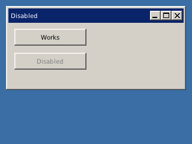

<!-- AUTOGENERATED COPYRIGHT HEADER START -->
<!-- Copyright (C) 2026 Claude <noreply@anthropic.com> -->
<!-- AUTOGENERATED COPYRIGHT HEADER END -->
<!-- Generated by tools/wiki/wiki.py. Edit tools/wiki/text/ instead of this file. -->
# DisableGadget

[Command Index](Command-Index) · [BlitzPlus](BlitzPlus) · [Gadgets](BlitzPlus-Gadgets)

```blitzbasic
DisableGadget gadget%
```

**Works in:** BlitzPlus

Greys a gadget out so it ignores the user and sends no events. A disabled window disables everything inside it. Combined with a child window this makes a dialog that blocks the window behind it.

```blitzbasic
Graphics 320, 240, 32, 2
win = CreateWindow("Disabled", 10, 10, 300, 140, Desktop(), 3)
ok  = CreateButton("Works", 10, 10, 120, 28, win)
no  = CreateButton("Disabled", 10, 50, 120, 28, win)
DisableGadget no
Repeat
Until WaitEvent() = $803
```



| Parameter | Type | Default | Description |
|---|---|---|---|
| `gadget` | Int | required | Handle of the gadget. |

## Related commands

* [ActivateGadget](ActivateGadget)
* [AddGadgetItem](AddGadgetItem)
* [ClearGadgetItems](ClearGadgetItems)
* [CountGadgetItems](CountGadgetItems)
* [EnableGadget](EnableGadget)
* [FreeGadget](FreeGadget)
* [HideGadget](HideGadget)
* [ShowGadget](ShowGadget)

[Command Index](Command-Index) · [BlitzPlus](BlitzPlus) · [Gadgets](BlitzPlus-Gadgets)
