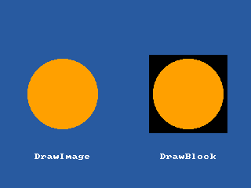

<!-- AUTOGENERATED COPYRIGHT HEADER START -->
<!-- Copyright (C) 2026 Claude <noreply@anthropic.com> -->
<!-- AUTOGENERATED COPYRIGHT HEADER END -->
<!-- Generated by tools/wiki/wiki.py. Edit tools/wiki/text/ instead of this file. -->


# DrawBlock

[Command Index](Command-Index) · [BlitzBasic](BlitzBasic) · [Images](BlitzBasic-Images)

## Command Syntax

```blitzbasic
DrawBlock image:Int32, x:Int32, y:Int32, frame:Int32=0
```

## Description

Draws a frame of an image without any transparency, so the mask color is drawn like any other. It is faster than [DrawImage](DrawImage) for pictures that fill a rectangle completely, such as backgrounds.

## Parameters

| Parameter | Type | Default | Description |
|---|---|---|---|
| `image` | Int32 | required | The image to draw. |
| `x` | Int32 | required | Horizontal position of the handle of the image. |
| `y` | Int32 | required | Vertical position of the handle of the image. |
| `frame` | Int32 | `0` | Which frame to draw. Defaults to 0. |

## Examples

```blitzbasic
Graphics 320, 240, 0, 2
SetBuffer BackBuffer()
Local img = CreateImage(100, 100)
SetBuffer ImageBuffer(img)
Color 255, 160, 0
Oval 5, 5, 90, 90, 1
SetBuffer BackBuffer()
Cls
Color 40, 90, 160
Rect 0, 0, 320, 240, 1
DrawImage img, 30, 70
DrawBlock img, 190, 70
Color 255, 255, 255
Text 80, 200, "DrawImage", 1, 1
Text 240, 200, "DrawBlock", 1, 1
Flip
WaitKey
```

## Media



## Related Commands

* [DrawBlockRect](DrawBlockRect)
* [DrawImage](DrawImage)
* [DrawImageRect](DrawImageRect)
* [TileBlock](TileBlock)

[Command Index](Command-Index) · [BlitzBasic](BlitzBasic) · [Images](BlitzBasic-Images)
