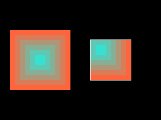

<!-- AUTOGENERATED COPYRIGHT HEADER START -->
<!-- Copyright (C) 2026 Claude <noreply@anthropic.com> -->
<!-- AUTOGENERATED COPYRIGHT HEADER END -->
<!-- Generated by tools/wiki/wiki.py. Edit tools/wiki/text/ instead of this file. -->
# DrawImageRect

[Command Index](Command-Index) · [BlitzBasic](BlitzBasic) · [Images](BlitzBasic-Images)

```blitzbasic
DrawImageRect image:Int32, x:Int32, y:Int32, rect_x:Int32, rect_y:Int32, rect_width:Int32, rect_height:Int32, frame:Int32=0
```

**Works in:** Blitz2D, BlitzPlus, Blitz3D

Draws only a rectangle of a frame, with the mask color left out. It can show a part of a big picture or cut a sheet into tiles. The handle of the image is not used: the top left corner of the rectangle goes to the given position.

```blitzbasic
Graphics 320, 240, 0, 2
SetBuffer BackBuffer()
Local img = CreateImage(120, 120)
SetBuffer ImageBuffer(img)
For i = 0 To 5
	Color 255 - i * 40, 100 + i * 25, 60 + i * 30
	Rect i * 10, i * 10, 120 - i * 20, 120 - i * 20, 1
Next
SetBuffer BackBuffer()
Cls
DrawImage img, 20, 60
DrawImageRect img, 180, 80, 40, 40, 80, 80
Color 255, 255, 255
Rect 180 - 1, 80 - 1, 82, 82, 0
Flip
WaitKey
```



| Parameter | Type | Default | Description |
|---|---|---|---|
| `image` | Int32 | required | The image to draw. |
| `x` | Int32 | required | Horizontal position on the screen of the top left corner of the part. |
| `y` | Int32 | required | Vertical position on the screen of the top left corner of the part. |
| `rect_x` | Int32 | required | Left edge of the part inside the frame. |
| `rect_y` | Int32 | required | Top edge of the part inside the frame. |
| `rect_width` | Int32 | required | Width of the part. |
| `rect_height` | Int32 | required | Height of the part. |
| `frame` | Int32 | `0` | Which frame to draw. Defaults to 0. |

**Differences and known gaps:**

* Only the part that lies inside the frame is drawn. A rectangle that reaches over the edge is cut off.

## Related commands

* [CopyImage](CopyImage)
* [CreateImage](CreateImage)
* [DrawBlock](DrawBlock)
* [DrawBlockRect](DrawBlockRect)
* [DrawImage](DrawImage)
* [FreeImage](FreeImage)
* [ImageRectCollide](ImageRectCollide)
* [ImageRectOverlap](ImageRectOverlap)

[Command Index](Command-Index) · [BlitzBasic](BlitzBasic) · [Images](BlitzBasic-Images)
