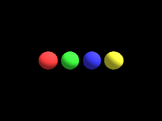

<!-- AUTOGENERATED COPYRIGHT HEADER START -->
<!-- Copyright (C) 2026 Claude <noreply@anthropic.com> -->
<!-- AUTOGENERATED COPYRIGHT HEADER END -->
<!-- Generated by tools/wiki/wiki.py. Edit tools/wiki/text/ instead of this file. -->
# EntityColor

[Command Index](Command-Index) · [Blitz3D](Blitz3D) · [Entities](Blitz3D-Entities)

## Command Syntax

```blitzbasic
EntityColor entity:Int32, red:Float32, green:Float32, blue:Float32
```

## Description

**Works in:** Blitz3D

Sets the color of the entity, multiplied with its texture. The default is 255, 255, 255. With the vertex color flag of [EntityFX](EntityFX) the original ignores it and shows the vertex colors only; here it is always multiplied with them, which is the same while the vertices are white.

## Parameters

| Parameter | Type | Default | Description |
|---|---|---|---|
| `entity` | Int32 | required | Entity handle. |
| `red` | Float32 | required | Red part, 0 to 255. |
| `green` | Float32 | required | Green part, 0 to 255. |
| `blue` | Float32 | required | Blue part, 0 to 255. |

## Examples

```blitzbasic
Graphics3D 320, 240, 0, 2
SetBuffer BackBuffer()
camera = CreateCamera()
PositionEntity camera, 0, 0, -9
light = CreateLight()
RotateEntity light, 45, 45, 0
For i = 0 To 3
	ball = CreateSphere(16)
	PositionEntity ball, i * 2.4 - 3.6, 0, 0
	Select i
		Case 0 : EntityColor ball, 255, 60, 60
		Case 1 : EntityColor ball, 60, 255, 60
		Case 2 : EntityColor ball, 60, 60, 255
		Case 3 : EntityColor ball, 255, 255, 60
	End Select
Next
RenderWorld
Flip
WaitKey
```

## Media



## Related Commands

* [EntityAlpha](EntityAlpha)
* [EntityAutoFade](EntityAutoFade)
* [EntityBlend](EntityBlend)
* [EntityClass](EntityClass)
* [EntityDistance](EntityDistance)
* [EntityFX](EntityFX)
* [EntityInView](EntityInView)
* [EntityName](EntityName)

[Command Index](Command-Index) · [Blitz3D](Blitz3D) · [Entities](Blitz3D-Entities)
