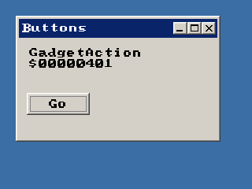

<!-- AUTOGENERATED COPYRIGHT HEADER START -->
<!-- Copyright (C) 2026 Claude <noreply@anthropic.com> -->
<!-- AUTOGENERATED COPYRIGHT HEADER END -->
<!-- Generated by tools/wiki/wiki.py. Edit tools/wiki/text/ instead of this file. -->


# EventID

<div align="center">

[Command Index](Command-Index) · [BlitzPlus](BlitzPlus) · [Events](BlitzPlus-Events)

</div>


## Command Syntax

```blitzbasic
EventID:Int32
```

## Description

Gives the kind of the event that [WaitEvent](WaitEvent) took last, which is the same number that function returned. See the table at [EventData](EventData) for all kinds.

## Parameters

**Returns:** The kind of the event. 0 after a `WaitEvent` that timed out.

## Examples

```blitzbasic
Graphics 320, 240, 32, 2
win  = CreateWindow("Buttons", 20, 20, 260, 160, Desktop(), 3)
info = CreateLabel("Click the button", 10, 10, 230, 40, win)
go   = CreateButton("Go", 10, 70, 80, 28, win)
Repeat
	Select WaitEvent()
		Case $401
			If EventSource() = go Then SetGadgetText info, "GadgetAction $" + Hex$(EventID())
		Case $803
			End
	End Select
Forever
```

## Media



## Related Commands

* [EventData](EventData)
* [EventSource](EventSource)
* [EventX](EventX)
* [EventY](EventY)
* [EventZ](EventZ)
* [PeekEvent](PeekEvent)
* [WaitEvent](WaitEvent)

<div align="center">

[Command Index](Command-Index) · [BlitzPlus](BlitzPlus) · [Events](BlitzPlus-Events)

</div>
