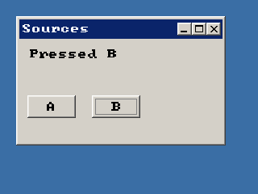

<!-- AUTOGENERATED COPYRIGHT HEADER START -->
<!-- Copyright (C) 2026 Claude <noreply@anthropic.com> -->
<!-- AUTOGENERATED COPYRIGHT HEADER END -->
<!-- Generated by tools/wiki/wiki.py. Edit tools/wiki/text/ instead of this file. -->
# EventSource

[Command Index](Command-Index) · [BlitzPlus](BlitzPlus) · [Events](BlitzPlus-Events)

## Command Syntax

```blitzbasic
EventSource:Int32
```

## Description

**Works in:** BlitzPlus

Gives the object that caused the last event: the gadget that was clicked, the window that moved or the timer that ticked. Compare it with the handles you got when you made them to find out which one it was.

## Parameters

**Returns:** A handle, or 0 for events that have no source such as keys and menus.

## Examples

```blitzbasic
Graphics 320, 240, 32, 2
win  = CreateWindow("Sources", 20, 20, 260, 160, Desktop(), 3)
info = CreateLabel("Click a button", 10, 10, 230, 40, win)
a    = CreateButton("A", 10, 70, 60, 28, win)
b    = CreateButton("B", 90, 70, 60, 28, win)
Repeat
	e = WaitEvent()
	If e = $401 Then
		If EventSource() = a Then SetGadgetText info, "Pressed A"
		If EventSource() = b Then SetGadgetText info, "Pressed B"
	EndIf
Until e = $803
```

## Media



## Related Commands

* [EventData](EventData)
* [EventID](EventID)
* [EventX](EventX)
* [EventY](EventY)
* [EventZ](EventZ)
* [PeekEvent](PeekEvent)
* [WaitEvent](WaitEvent)

[Command Index](Command-Index) · [BlitzPlus](BlitzPlus) · [Events](BlitzPlus-Events)
