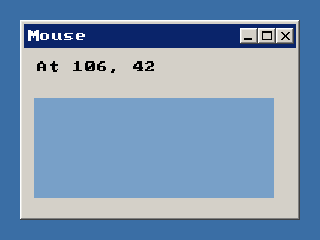

<!-- AUTOGENERATED COPYRIGHT HEADER START -->
<!-- Copyright (C) 2026 Claude <noreply@anthropic.com> -->
<!-- AUTOGENERATED COPYRIGHT HEADER END -->
<!-- Generated by tools/wiki/wiki.py. Edit tools/wiki/text/ instead of this file. -->
# EventX

[Command Index](Command-Index) · [BlitzPlus](BlitzPlus) · [Events](BlitzPlus-Events)

```blitzbasic
EventX:Int32
```

**Works in:** BlitzPlus

Gives the first coordinate of the last event: where the mouse was for $203 and $205, and where a window went to for $801 or how wide it became for $802.

```blitzbasic
Graphics 320, 240, 32, 2
win  = CreateWindow("Mouse", 20, 20, 280, 200, Desktop(), 3)
info = CreateLabel("Move the mouse", 10, 10, 250, 30, win)
cv   = CreateCanvas(10, 50, 240, 100, win)
SetBuffer CanvasBuffer(cv)
ClsColor 120, 160, 200
Cls
FlipCanvas cv
Repeat
	e = WaitEvent()
	If e = $203 Then SetGadgetText info, "At " + EventX() + ", " + EventY()
Until e = $803
```



**Returns:** The X value, see the table at [EventData](EventData). Positions on a canvas are relative to the canvas.

## Related commands

* [EventData](EventData)
* [EventID](EventID)
* [EventSource](EventSource)
* [EventY](EventY)
* [EventZ](EventZ)
* [PeekEvent](PeekEvent)
* [WaitEvent](WaitEvent)

[Command Index](Command-Index) · [BlitzPlus](BlitzPlus) · [Events](BlitzPlus-Events)
