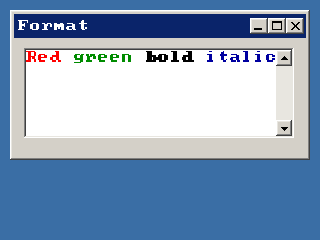

<!-- AUTOGENERATED COPYRIGHT HEADER START -->
<!-- Copyright (C) 2026 Claude <noreply@anthropic.com> -->
<!-- AUTOGENERATED COPYRIGHT HEADER END -->
<!-- Generated by tools/wiki/wiki.py. Edit tools/wiki/text/ instead of this file. -->


# FormatTextAreaText

[Command Index](Command-Index) · [BlitzPlus](BlitzPlus) · [Text Areas](BlitzPlus-Text-Areas)

## Command Syntax

```blitzbasic
FormatTextAreaText textarea:Int32, red:Int32, green:Int32, blue:Int32, flags:Int32, pos:Int32=0, len:Int32=-1, units:Int32=1
```

## Description

Changes the color and style of a part of the text. The style is 1 for bold, 2 for italic and 3 for both, and 0 for plain. The part starts at a character or line and goes on for a number of them.

**Differences and known gaps:**

* Underline and strike-through are not supported, as in the original.

## Parameters

| Parameter | Type | Default | Description |
|---|---|---|---|
| `textarea` | Int32 | required | Handle of a text area. |
| `red` | Int32 | required | Red part of the text color, 0 to 255. |
| `green` | Int32 | required | Green part of the text color, 0 to 255. |
| `blue` | Int32 | required | Blue part of the text color, 0 to 255. |
| `flags` | Int32 | required |  |
| `pos` | Int32 | `0` |  |
| `len` | Int32 | `-1` |  |
| `units` | Int32 | `1` | 1 counts characters, 2 counts lines. Defaults to 1. |

## Examples

```blitzbasic
Graphics 320, 240, 32, 2
win  = CreateWindow("Format", 10, 10, 300, 150, Desktop(), 3)
area = CreateTextArea(10, 10, 270, 90, win)
SetGadgetText area, "Red green bold italic"
FormatTextAreaText area, 255, 0, 0, 0, 0, 3
FormatTextAreaText area, 0, 140, 0, 0, 4, 5
FormatTextAreaText area, 0, 0, 0, 1, 10, 4
FormatTextAreaText area, 0, 0, 160, 2, 15, 6
Repeat
Until WaitEvent() = $803
```

## Media



## Related Commands

* [AddTextAreaText](AddTextAreaText)
* [CreateTextArea](CreateTextArea)
* [LockTextArea](LockTextArea)
* [SetTextAreaColor](SetTextAreaColor)
* [SetTextAreaFont](SetTextAreaFont)
* [SetTextAreaText](SetTextAreaText)
* [TextAreaText](TextAreaText)
* [TextFieldText](TextFieldText)

[Command Index](Command-Index) · [BlitzPlus](BlitzPlus) · [Text Areas](BlitzPlus-Text-Areas)
