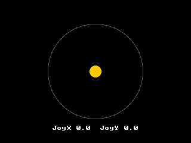

<!-- AUTOGENERATED COPYRIGHT HEADER START -->
<!-- Copyright (C) 2026 Claude <noreply@anthropic.com> -->
<!-- AUTOGENERATED COPYRIGHT HEADER END -->
<!-- Generated by tools/wiki/wiki.py. Edit tools/wiki/text/ instead of this file. -->
# JoyX

[Command Index](Command-Index) · [BlitzBasic](BlitzBasic) · [Joystick](BlitzBasic-Joystick)

## Command Syntax

```blitzbasic
JoyX:Float32 port:Int32=0
```

## Description

**Works in:** Blitz2D, BlitzPlus, Blitz3D

The horizontal position of the main stick, from -1 (left) to 1 (right). A small value close to 0 is normal even when the stick is released, so ignore values below a dead zone of about 0.1.

## Parameters

| Parameter | Type | Default | Description |
|---|---|---|---|
| `port` | Int32 | `0` | The joystick to ask, counted from 0. Defaults to 0. |

**Returns:** The position from -1 to 1, or 0 if there is no joystick.

## Examples

```blitzbasic
Graphics 320, 240, 0, 2
SetBuffer BackBuffer()
Cls
Color 90, 90, 90
Oval 80, 40, 160, 160, 0
Color 255, 200, 0
Oval 160 + JoyX() * 70 - 10, 120 + JoyY() * 70 - 10, 20, 20, 1
Color 255, 255, 255
Text 160, 215, "JoyX " + JoyX() + "  JoyY " + JoyY(), 1, 1
Flip
WaitKey
```

## Media



## Related Commands

* [JoyDown](JoyDown)
* [JoyHat](JoyHat)
* [JoyHit](JoyHit)
* [JoyPitch](JoyPitch)
* [JoyRoll](JoyRoll)
* [JoyType](JoyType)
* [JoyU](JoyU)
* [JoyXDir](JoyXDir)

[Command Index](Command-Index) · [BlitzBasic](BlitzBasic) · [Joystick](BlitzBasic-Joystick)
