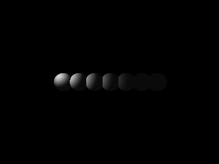

<!-- AUTOGENERATED COPYRIGHT HEADER START -->
<!-- Copyright (C) 2026 Claude <noreply@anthropic.com> -->
<!-- AUTOGENERATED COPYRIGHT HEADER END -->
<!-- Generated by tools/wiki/wiki.py. Edit tools/wiki/text/ instead of this file. -->


# LightRange

[Command Index](Command-Index) · [Blitz3D](Blitz3D) · [Lights](Blitz3D-Lights)

## Command Syntax

```blitzbasic
LightRange light:Int32, range:Float32
```

## Description

Sets how far a point or spot light reaches. The light is full strength next to the light and fades steadily to nothing at the range, so everything beyond it stays dark. The original calls the value approximate, so try a few values until the scene looks right. The default is 1000. Directional lights ignore it.

## Parameters

| Parameter | Type | Default | Description |
|---|---|---|---|
| `light` | Int32 | required | Light handle. |
| `range` | Float32 | required | How far the light reaches. |

## Examples

```blitzbasic
Graphics3D 320, 240, 0, 2
SetBuffer BackBuffer()
camera = CreateCamera()
PositionEntity camera, 0, 0, -12
AmbientLight 10, 10, 10
; A row of balls that starts at a point light with a short range.
light = CreateLight(2)
PositionEntity light, -5.5, 1.5, -2
LightRange light, 8
For i = 0 To 6
	ball = CreateSphere(16)
	PositionEntity ball, i * 1.7 - 5, 0, 0
Next
RenderWorld
Flip
WaitKey
```

## Media



## Related Commands

* [CreateLight](CreateLight)
* [LightColor](LightColor)
* [LightConeAngles](LightConeAngles)
* [LightMesh](LightMesh)

[Command Index](Command-Index) · [Blitz3D](Blitz3D) · [Lights](Blitz3D-Lights)
