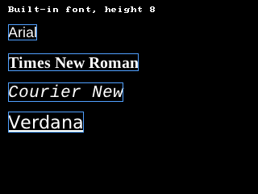

<!-- AUTOGENERATED COPYRIGHT HEADER START -->
<!-- Copyright (C) 2026 Claude <noreply@anthropic.com> -->
<!-- AUTOGENERATED COPYRIGHT HEADER END -->
<!-- Generated by tools/wiki/wiki.py. Edit tools/wiki/text/ instead of this file. -->
# LoadFont

[Command Index](Command-Index) · [BlitzBasic](BlitzBasic) · [Fonts and Text](BlitzBasic-Fonts-and-Text)

## Command Syntax

```blitzbasic
LoadFont:Int32 fontname:String, height:Int32=12, bold:Int32=0, italic:Int32=0, underline:Int32=0
```

## Description

**Works in:** Blitz2D, BlitzPlus, Blitz3D

Chooses a font by its name and size and returns a handle to use with [SetFont](SetFont). The height is measured in pixels of a character, and the default is 12.

**Differences and known gaps:**

* Fonts are found in the font folders of the system by name, so a name such as "Arial" or "Courier New" needs that font installed, and common names fall back to a similar font (Helvetica to Arial, for one). A name that has a dot in it is a font file, such as "fonts/my.ttf". Bold and italic use the bold and italic files of a family when there are any, and are made from the regular font when there are none. A font that is not found is drawn with the built-in 8x8 bitmap font, scaled to the height.

## Parameters

| Parameter | Type | Default | Description |
|---|---|---|---|
| `fontname` | String | required | The name of the font, such as "Arial". |
| `height` | Int32 | `12` | The height of a character in pixels. Defaults to 12. |
| `bold` | Int32 | `0` | True for a bold font. Defaults to False. |
| `italic` | Int32 | `0` | True for an italic font. Defaults to False. |
| `underline` | Int32 | `0` | True for an underlined font. Defaults to False. |

**Returns:** A handle for the font. A font that does not exist still gives a valid handle.

## Examples

```blitzbasic
Graphics 320, 240, 0, 2
SetBuffer BackBuffer()
Cls
Text 10, 8, "Built-in font, height " + FontHeight()
Local names$[3], i
names[0] = "Arial" : names[1] = "Times New Roman" : names[2] = "Courier New" : names[3] = "Verdana"
For i = 0 To 3
	f = LoadFont(names[i], 20 + i * 2, i = 1, i = 2, i = 3)
	SetFont f
	Text 10, 30 + i * 36, names[i]
	; StringWidth knows how wide the text is in this font, so a box can be drawn around it.
	Color 80, 160, 255
	Rect 10, 30 + i * 36, StringWidth(names[i]), FontHeight(), 0
	Color 255, 255, 255
	SetFont 0
	FreeFont f
Next
Flip
WaitKey
```

## Media



## Related Commands

* [FontHeight](FontHeight)
* [FontWidth](FontWidth)
* [FreeFont](FreeFont)
* [SetFont](SetFont)

[Command Index](Command-Index) · [BlitzBasic](BlitzBasic) · [Fonts and Text](BlitzBasic-Fonts-and-Text)
