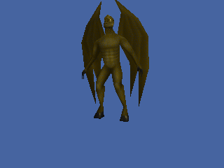

<!-- AUTOGENERATED COPYRIGHT HEADER START -->
<!-- Copyright (C) 2026 Claude <noreply@anthropic.com> -->
<!-- AUTOGENERATED COPYRIGHT HEADER END -->
<!-- Generated by tools/wiki/wiki.py. Edit tools/wiki/text/ instead of this file. -->
# LoadMD2

[Command Index](Command-Index) · [Blitz3D](Blitz3D) · [Animation](Blitz3D-Animation)

## Command Syntax

```blitzbasic
LoadMD2:Int32 file:String, parent:Int32=0
```

## Description

**Works in:** Blitz3D

Loads a Quake 2 model (.md2). The model is made of a single mesh that moves from frame to frame, so it has its own commands, [AnimateMD2](AnimateMD2) and the MD2Anim commands, and does not work with the other animation commands. The picture of the model is a separate file: load it with [LoadTexture](LoadTexture) and give it to the model with [EntityTexture](EntityTexture), otherwise the model is not textured.

A parent makes the model follow another entity. The model is still created at 0, 0, 0 and not at the parent's position, and moving the model does not move the parent.

Case matters for file names on Linux, so use the exact spelling of the files.

## Parameters

| Parameter | Type | Default | Description |
|---|---|---|---|
| `file` | String | required | The .md2 file. |
| `parent` | Int32 | `0` | Optional parent entity. |

**Returns:** An entity handle, or 0 if the file could not be loaded.

## Examples

```blitzbasic
; Uses the Gargoyle model of the Blitz3D samples, which are run from the folder that contains "media".
Graphics3D 320, 240, 0, 2
SetBuffer BackBuffer()
camera = CreateCamera()
CameraClsColor camera, 70, 100, 160
light = CreateLight()
RotateEntity light, 40, 30, 0

gargoyle = LoadMD2("media/Gargoyle/Gargoyle.md2")
skin = LoadTexture("media/Gargoyle/Gargoyle.bmp")
EntityTexture gargoyle, skin
PositionEntity gargoyle, 0, -30, 100
RotateEntity gargoyle, 0, 160, 0

AnimateMD2 gargoyle, 1, 1, 1, 40
For i = 0 To 39
	UpdateWorld
	RenderWorld
	Delay 50
	Flip
Next
```

## Media



## Related Commands

* [AnimateMD2](AnimateMD2)
* [LoadAnimSeq](LoadAnimSeq)
* [MD2Animating](MD2Animating)
* [MD2AnimLength](MD2AnimLength)
* [MD2AnimTime](MD2AnimTime)

[Command Index](Command-Index) · [Blitz3D](Blitz3D) · [Animation](Blitz3D-Animation)
