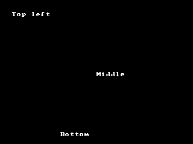

<!-- AUTOGENERATED COPYRIGHT HEADER START -->
<!-- Copyright (C) 2026 Claude <noreply@anthropic.com> -->
<!-- AUTOGENERATED COPYRIGHT HEADER END -->
<!-- Generated by tools/wiki/wiki.py. Edit tools/wiki/text/ instead of this file. -->


# Locate

<div align="center">

[Command Index](Command-Index) · [BlitzBasic](BlitzBasic) · [Fonts and Text](BlitzBasic-Fonts-and-Text)

</div>


## Command Syntax

```blitzbasic
Locate x:Int32, y:Int32
```

## Parameters

| Parameter | Type | Default | Description |
|---|---|---|---|
| `x` | Int32 | required | Horizontal position of the cursor in pixels. |
| `y` | Int32 | required | Vertical position of the cursor in pixels. |

## Description

Moves the text cursor of [Print](Print) and [Write](Write) to a position in pixels. The position is on the screen and not in the current buffer.

## Differences

* The position is limited to the window.

## Examples

```blitzbasic
Graphics 320, 240, 0, 2
Cls
Locate 20, 20
Print "Top left"
Locate 160, 120
Print "Middle"
Locate 100, 220
Print "Bottom"
WaitKey
```

## Media



## Related Commands

* [Input](Input)
* [LoadFont](LoadFont)
* [Print](Print)
* [SetFont](SetFont)

<div align="center">

[Command Index](Command-Index) · [BlitzBasic](BlitzBasic) · [Fonts and Text](BlitzBasic-Fonts-and-Text)

</div>
