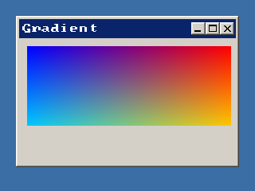

<!-- AUTOGENERATED COPYRIGHT HEADER START -->
<!-- Copyright (C) 2026 Claude <noreply@anthropic.com> -->
<!-- AUTOGENERATED COPYRIGHT HEADER END -->
<!-- Generated by tools/wiki/wiki.py. Edit tools/wiki/text/ instead of this file. -->
# LockedPixels

[Command Index](Command-Index) · [BlitzPlus](BlitzPlus) · [Canvas](BlitzPlus-Canvas)

## Command Syntax

```blitzbasic
LockedPixels:Int32 buffer:Int32=0
```

## Description

**Works in:** BlitzPlus

Gives the pixels of a locked buffer as a bank, so you can read and write them with `PeekByte`, `PokeInt` and friends, which is quicker than `ReadPixel` and `WritePixel` for many pixels. Change them, call `UnlockBuffer` and the changes show up in the buffer.

**Differences and known gaps:**

* The bank is a copy of the pixels that is written back when the buffer is unlocked, it is not the memory of the graphics card. Nothing is changed before `UnlockBuffer`.

## Parameters

| Parameter | Type | Default | Description |
|---|---|---|---|
| `buffer` | Int32 | `0` | Locked buffer. Defaults to the current one. |

**Returns:** The handle of a bank with the pixels.

## Examples

```blitzbasic
Graphics 320, 240, 32, 2
win = CreateWindow("Gradient", 20, 20, 280, 190, Desktop(), 3)
cv  = CreateCanvas(10, 10, 256, 100, win)
buf = CanvasBuffer(cv)
LockBuffer buf
bank  = LockedPixels(buf)
pitch = LockedPitch(buf)
For y = 0 To 99
	For x = 0 To 255
		PokeInt bank, y * pitch + x * 4, $FF000000 Or (x Shl 16) Or (y * 2 Shl 8) Or (255 - x)
	Next
Next
UnlockBuffer buf
FlipCanvas cv
Repeat
Until WaitEvent() = $803
```

## Media



## Related Commands

* [LockedFormat](LockedFormat)
* [LockedPitch](LockedPitch)

[Command Index](Command-Index) · [BlitzPlus](BlitzPlus) · [Canvas](BlitzPlus-Canvas)
