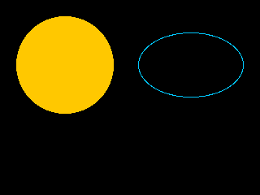

<!-- AUTOGENERATED COPYRIGHT HEADER START -->
<!-- Copyright (C) 2026 Claude <noreply@anthropic.com> -->
<!-- AUTOGENERATED COPYRIGHT HEADER END -->
<!-- Generated by tools/wiki/wiki.py. Edit tools/wiki/text/ instead of this file. -->


# Oval

<div align="center">

[Command Index](Command-Index) · [BlitzBasic](BlitzBasic) · [Drawing](BlitzBasic-Drawing)

</div>


## Command Syntax

```blitzbasic
Oval x:Int32, y:Int32, width:Int32, height:Int32, solid:Int32=1
```

## Parameters

| Parameter | Type | Default | Description |
|---|---|---|---|
| `x` | Int32 | required | Horizontal position of the left side of the box. |
| `y` | Int32 | required | Vertical position of the top of the box. |
| `width` | Int32 | required | Width of the box. |
| `height` | Int32 | required | Height of the box. |
| `solid` | Int32 | `1` | 1 fills the ellipse, 0 draws only its outline. Defaults to 1. |

## Description

Draws an ellipse inside the box given by position and size.

## Examples

```blitzbasic
Graphics 320, 240, 0, 2
SetBuffer BackBuffer()
Cls
Color 255, 200, 0
Oval 20, 20, 120, 120, 1
Color 0, 200, 255
Oval 170, 40, 130, 80, 0
Flip
WaitKey
```

## Media



## Related Commands

* [Line](Line)
* [Origin](Origin)
* [Plot](Plot)
* [Rect](Rect)

<div align="center">

[Command Index](Command-Index) · [BlitzBasic](BlitzBasic) · [Drawing](BlitzBasic-Drawing)

</div>
