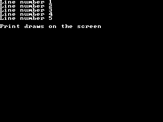

<!-- AUTOGENERATED COPYRIGHT HEADER START -->
<!-- Copyright (C) 2026 Claude <noreply@anthropic.com> -->
<!-- AUTOGENERATED COPYRIGHT HEADER END -->
<!-- Generated by tools/wiki/wiki.py. Edit tools/wiki/text/ instead of this file. -->
# Print

[Command Index](Command-Index) · [BlitzBasic](BlitzBasic) · [Fonts and Text](BlitzBasic-Fonts-and-Text)

```blitzbasic
Print string$=\
```

**Works in:** Blitz2D, BlitzPlus, Blitz3D

Writes a line of text at the text cursor and moves the cursor to the start of the next line. When it reaches the bottom of the window the picture scrolls up. With no text it only moves the cursor. Print draws straight onto the screen, so it needs no [Flip](Flip). For text that is part of a frame that is drawn into the back buffer, use [Text](Text).

```blitzbasic
Graphics 320, 240, 0, 2
Cls
For i = 1 To 5
	Print "Line number " + i
Next
Print
Print "Print draws on the screen"
WaitKey
```



| Parameter | Type | Default | Description |
|---|---|---|---|
| `string` | String | `\` | The text to write. Defaults to an empty line. |

**Differences and known gaps:**

* Without a graphics window the text goes to the console instead.
* The text is drawn in the drawing color, in the current font, onto the front buffer.

## Related commands

* [LoadFont](LoadFont)
* [Locate](Locate)
* [SetFont](SetFont)
* [StringHeight](StringHeight)

[Command Index](Command-Index) · [BlitzBasic](BlitzBasic) · [Fonts and Text](BlitzBasic-Fonts-and-Text)
