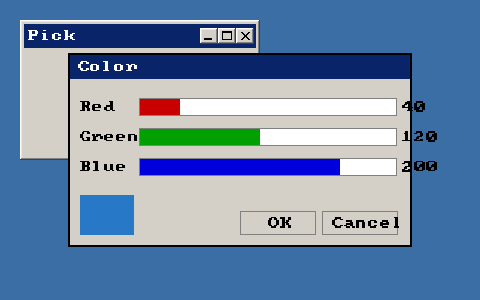

<!-- AUTOGENERATED COPYRIGHT HEADER START -->
<!-- Copyright (C) 2026 Claude <noreply@anthropic.com> -->
<!-- AUTOGENERATED COPYRIGHT HEADER END -->
<!-- Generated by tools/wiki/wiki.py. Edit tools/wiki/text/ instead of this file. -->
# RequestColor

[Command Index](Command-Index) · [BlitzPlus](BlitzPlus) · [Dialogs](BlitzPlus-Dialogs)

```blitzbasic
RequestColor:Int32 red:Int32=255, green:Int32=255, blue:Int32=255
```

**Works in:** BlitzPlus

Opens a color picker with three sliders and waits until the user presses OK or Cancel. Read the picked color with [RequestedRed](RequestedRed), [RequestedGreen](RequestedGreen) and [RequestedBlue](RequestedBlue). While the picker is open nothing else in the program window reacts.

```blitzbasic
Graphics 480, 300, 32, 2
win   = CreateWindow("Pick", 20, 20, 240, 140, Desktop(), 3)
swatch = CreatePanel(20, 20, 100, 60, win)
If RequestColor(40, 120, 200) Then
	SetPanelColor swatch, RequestedRed(), RequestedGreen(), RequestedBlue()
EndIf
Repeat
Until WaitEvent() = $803
```



| Parameter | Type | Default | Description |
|---|---|---|---|
| `red` | Int32 | `255` | Red the sliders start at, 0 to 255. Defaults to 255. |
| `green` | Int32 | `255` | Green the sliders start at, 0 to 255. Defaults to 255. |
| `blue` | Int32 | `255` | Blue the sliders start at, 0 to 255. Defaults to 255. |

**Returns:** 1 if the user pressed OK, 0 if the dialog was cancelled.

**Differences and known gaps:**

* The picker is drawn by the program inside its own window and is simpler than the Windows color dialog: three sliders and a preview, no palette and no custom colors. Return confirms and Escape cancels.

## Related commands

* [RequestDir](RequestDir)
* [RequestedBlue](RequestedBlue)
* [RequestFile](RequestFile)
* [RequestFont](RequestFont)

[Command Index](Command-Index) · [BlitzPlus](BlitzPlus) · [Dialogs](BlitzPlus-Dialogs)
