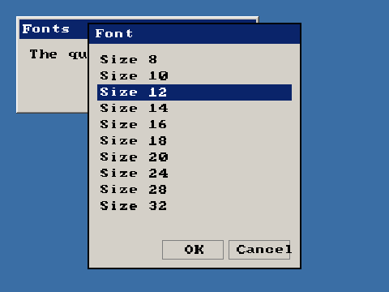

<!-- AUTOGENERATED COPYRIGHT HEADER START -->
<!-- Copyright (C) 2026 Claude <noreply@anthropic.com> -->
<!-- AUTOGENERATED COPYRIGHT HEADER END -->
<!-- Generated by tools/wiki/wiki.py. Edit tools/wiki/text/ instead of this file. -->


# RequestFont

[Command Index](Command-Index) · [BlitzPlus](BlitzPlus) · [Dialogs](BlitzPlus-Dialogs)

## Command Syntax

```blitzbasic
RequestFont:Int32
```

## Description

Opens a font picker and gives a font that was chosen, or 0 if the user cancelled. The font works with `SetFont`, [SetGadgetFont](SetGadgetFont) and [FontName](FontName).

**Differences and known gaps:**

* Only the size can be picked, from 8 to 32 points in a list, and the result is always the built-in font. There is no font name, bold, italic or underline choice, and no preview.

## Parameters

**Returns:** A font handle, or 0 if cancelled.

## Examples

```blitzbasic
Graphics 480, 360, 32, 2
win   = CreateWindow("Fonts", 20, 20, 300, 120, Desktop(), 3)
label = CreateLabel("The quick brown fox", 10, 10, 270, 50, win)
font = RequestFont()
If font Then SetGadgetFont label, font
Repeat
Until WaitEvent() = $803
```

## Media



## Related Commands

* [RequestColor](RequestColor)
* [RequestDir](RequestDir)
* [RequestedRed](RequestedRed)
* [RequestFile](RequestFile)

[Command Index](Command-Index) · [BlitzPlus](BlitzPlus) · [Dialogs](BlitzPlus-Dialogs)
