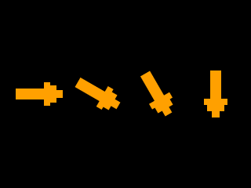

<!-- AUTOGENERATED COPYRIGHT HEADER START -->
<!-- Copyright (C) 2026 Claude <noreply@anthropic.com> -->
<!-- AUTOGENERATED COPYRIGHT HEADER END -->
<!-- Generated by tools/wiki/wiki.py. Edit tools/wiki/text/ instead of this file. -->
# RotateImage

[Command Index](Command-Index) · [BlitzBasic](BlitzBasic) · [Images](BlitzBasic-Images)

```blitzbasic
RotateImage image%, angle#
```

**Works in:** Blitz2D, BlitzPlus, Blitz3D

Turns every frame of an image around its handle by an angle in degrees, clockwise when positive. The image gets larger so that the whole picture fits, and the corners that are added are masked. The change is permanent and cumulative, and every rotation blurs the picture a little, so rotate a copy of the original image.

```blitzbasic
Graphics 320, 240, 0, 2
SetBuffer BackBuffer()
Local arrow = CreateImage(60, 30)
SetBuffer ImageBuffer(arrow)
Color 255, 160, 0
Rect 0, 8, 40, 14, 1
Rect 36, 0, 8, 30, 1
Rect 44, 4, 8, 22, 1
Rect 52, 10, 8, 10, 1
SetBuffer BackBuffer()
Cls
For i = 0 To 3
	Local r = CopyImage(arrow)
	MidHandle r
	RotateImage r, i * 30
	DrawImage r, 50 + i * 75, 120
Next
Flip
WaitKey
```



| Parameter | Type | Default | Description |
|---|---|---|---|
| `image` | Int | required | The image. |
| `angle` | Float | required | The angle in degrees. |

## Related commands

* [CopyImage](CopyImage)
* [CreateImage](CreateImage)
* [DrawImage](DrawImage)
* [FreeImage](FreeImage)
* [GrabImage](GrabImage)
* [HandleImage](HandleImage)
* [LoadAnimImage](LoadAnimImage)
* [LoadImage](LoadImage)

[Command Index](Command-Index) · [BlitzBasic](BlitzBasic) · [Images](BlitzBasic-Images)
