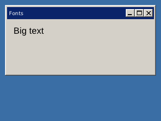

<!-- AUTOGENERATED COPYRIGHT HEADER START -->
<!-- Copyright (C) 2026 Claude <noreply@anthropic.com> -->
<!-- AUTOGENERATED COPYRIGHT HEADER END -->
<!-- Generated by tools/wiki/wiki.py. Edit tools/wiki/text/ instead of this file. -->
# SetGadgetFont

[Command Index](Command-Index) · [BlitzPlus](BlitzPlus) · [Gadgets](BlitzPlus-Gadgets)

```blitzbasic
SetGadgetFont gadget%, font%
```

**Works in:** BlitzPlus

Makes a gadget draw its text with another font.

```blitzbasic
Graphics 320, 240, 32, 2
win = CreateWindow("Fonts", 10, 10, 300, 140, Desktop(), 3)
big = LoadFont("Arial", 20)
lab = CreateLabel("Big text", 10, 10, 250, 40, win)
SetGadgetFont lab, big
Repeat
Until WaitEvent() = $803
```



| Parameter | Type | Default | Description |
|---|---|---|---|
| `gadget` | Int | required | Handle of the gadget. |
| `font` | Int | required | Font handle from `LoadFont` or [RequestFont](RequestFont). |

**Differences and known gaps:**

* Only the size of the font is used. Every font is drawn with the built-in typeface.

## Related commands

* [GadgetFont](GadgetFont)
* [SetButtonState](SetButtonState)
* [SetGadgetLayout](SetGadgetLayout)
* [SetGadgetShape](SetGadgetShape)
* [SetGadgetText](SetGadgetText)
* [SetPanelColor](SetPanelColor)
* [SetPanelImage](SetPanelImage)
* [SetSliderRange](SetSliderRange)

[Command Index](Command-Index) · [BlitzPlus](BlitzPlus) · [Gadgets](BlitzPlus-Gadgets)
