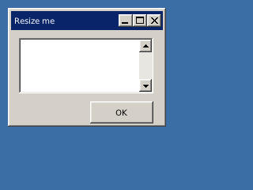

<!-- AUTOGENERATED COPYRIGHT HEADER START -->
<!-- Copyright (C) 2026 Claude <noreply@anthropic.com> -->
<!-- AUTOGENERATED COPYRIGHT HEADER END -->
<!-- Generated by tools/wiki/wiki.py. Edit tools/wiki/text/ instead of this file. -->
# SetGadgetLayout

[Command Index](Command-Index) · [BlitzPlus](BlitzPlus) · [Gadgets](BlitzPlus-Gadgets)

```blitzbasic
SetGadgetLayout gadget%, left%, right%, top%, bottom%
```

**Works in:** BlitzPlus

Says how a gadget follows its group when it changes size. Each side can be 0 for free (the distance to that edge changes), 1 for locked (the distance stays) or 2 for proportional (it scales with the group). The default is left and top locked.

```blitzbasic
Graphics 320, 240, 32, 2
win = CreateWindow("Resize me", 10, 10, 200, 150, Desktop(), 3)
box = CreateTextArea(10, 10, 170, 70, win)
SetGadgetLayout box, 1, 1, 1, 1
ok  = CreateButton("OK", 100, 90, 80, 28, win)
SetGadgetLayout ok, 0, 1, 0, 1
Repeat
Until WaitEvent() = $803
```



| Parameter | Type | Default | Description |
|---|---|---|---|
| `gadget` | Int | required | Handle of the gadget. |
| `left` | Int | required | Behavior of the left edge: 0, 1 or 2. |
| `right` | Int | required | Behavior of the right edge: 0, 1 or 2. |
| `top` | Int | required | Behavior of the top edge: 0, 1 or 2. |
| `bottom` | Int | required | Behavior of the bottom edge: 0, 1 or 2. |

## Related commands

* [SetButtonState](SetButtonState)
* [SetGadgetFont](SetGadgetFont)
* [SetGadgetShape](SetGadgetShape)
* [SetGadgetText](SetGadgetText)
* [SetPanelColor](SetPanelColor)
* [SetPanelImage](SetPanelImage)
* [SetSliderRange](SetSliderRange)
* [SetSliderValue](SetSliderValue)

[Command Index](Command-Index) · [BlitzPlus](BlitzPlus) · [Gadgets](BlitzPlus-Gadgets)
