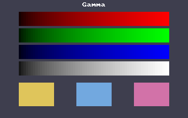

<!-- AUTOGENERATED COPYRIGHT HEADER START -->
<!-- Copyright (C) 2026 Claude <noreply@anthropic.com> -->
<!-- AUTOGENERATED COPYRIGHT HEADER END -->
<!-- Generated by tools/wiki/wiki.py. Edit tools/wiki/text/ instead of this file. -->


# SetGamma

[Command Index](Command-Index) · [BlitzBasic](BlitzBasic) · [Display](BlitzBasic-Display)

## Command Syntax

```blitzbasic
SetGamma src_red:Int32, src_green:Int32, src_blue:Int32, dest_red:Float32, dest_green:Float32, dest_blue:Float32
```

## Description

Sets one entry of the gamma tables: color value `src` of a channel is shown as the output value, which can be a fractional number from 0 to 255. Call [UpdateGamma](UpdateGamma) after changing the entries, which is when they start to count. The tables change what the window shows, not what was drawn, so [ReadPixel](ReadPixel) and [SaveBuffer](SaveBuffer) still see the colors the program drew.

This example raises every step to the power of 1 / 1.8, which brightens the dark colors most. The first picture is the window before, the second after.

**Differences and known gaps:**

* The original changed the gamma of the whole display, and left it that way until the program was done. This never changes the gamma of the display, and the window is the only thing that looks different: the tables are applied to the picture of the window when it is shown, by the GPU, and the buffers keep what was drawn. The output values are floats, and it works in a window as well as in full screen.

## Parameters

| Parameter | Type | Default | Description |
|---|---|---|---|
| `src_red` | Int32 | required | The input value for the red table, 0 to 255. |
| `src_green` | Int32 | required | The input value for the green table, 0 to 255. |
| `src_blue` | Int32 | required | The input value for the blue table, 0 to 255. |
| `dest_red` | Float32 | required | The output value for red. |
| `dest_green` | Float32 | required | The output value for green. |
| `dest_blue` | Float32 | required | The output value for blue. |

## Examples

```blitzbasic
Graphics 320, 200, 32, 2
SetBuffer BackBuffer()
For i = 0 To 63
	v = i * 4 + 3
	Color v, 0, 0 : Rect 32 + i * 4, 20, 4, 24, 1
	Color 0, v, 0 : Rect 32 + i * 4, 48, 4, 24, 1
	Color 0, 0, v : Rect 32 + i * 4, 76, 4, 24, 1
	Color v, v, v : Rect 32 + i * 4, 104, 4, 24, 1
Next
Flip

For i = 0 To 255
	bright# = 255.0 * (i / 255.0) ^ (1.0 / 1.8)
	SetGamma i, i, i, bright, bright, bright
Next
UpdateGamma
Flip
WaitKey
```



## Related Commands

* [GammaBlue](GammaBlue)
* [GammaGreen](GammaGreen)
* [GammaRed](GammaRed)
* [SetGfxDriver](SetGfxDriver)
* [UpdateGamma](UpdateGamma)

[Command Index](Command-Index) · [BlitzBasic](BlitzBasic) · [Display](BlitzBasic-Display)
