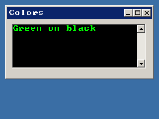

<!-- AUTOGENERATED COPYRIGHT HEADER START -->
<!-- Copyright (C) 2026 Claude <noreply@anthropic.com> -->
<!-- AUTOGENERATED COPYRIGHT HEADER END -->
<!-- Generated by tools/wiki/wiki.py. Edit tools/wiki/text/ instead of this file. -->
# SetTextAreaColor

[Command Index](Command-Index) · [BlitzPlus](BlitzPlus) · [Text Areas](BlitzPlus-Text-Areas)

```blitzbasic
SetTextAreaColor textarea%, red%, green%, blue%, background%=0
```

**Works in:** BlitzPlus

Sets the color of the text, or with the last parameter the color of the background, of the whole text area.

```blitzbasic
Graphics 320, 240, 32, 2
win  = CreateWindow("Colors", 10, 10, 300, 150, Desktop(), 3)
area = CreateTextArea(10, 10, 270, 90, win)
SetGadgetText area, "Green on black"
SetTextAreaColor area, 0, 0, 0, 1
SetTextAreaColor area, 0, 255, 0
Repeat
Until WaitEvent() = $803
```



| Parameter | Type | Default | Description |
|---|---|---|---|
| `textarea` | Int | required | Handle of a text area. |
| `red` | Int | required | Red part, 0 to 255. |
| `green` | Int | required | Green part, 0 to 255. |
| `blue` | Int | required | Blue part, 0 to 255. |
| `background` | Int | `0` | 0 sets the text color, 1 sets the background color. Defaults to 0. |

## Related commands

* [AddTextAreaText](AddTextAreaText)
* [CreateTextArea](CreateTextArea)
* [FormatTextAreaText](FormatTextAreaText)
* [LockTextArea](LockTextArea)
* [SetTextAreaFont](SetTextAreaFont)
* [SetTextAreaTabs](SetTextAreaTabs)
* [SetTextAreaText](SetTextAreaText)
* [TextAreaChar](TextAreaChar)

[Command Index](Command-Index) · [BlitzPlus](BlitzPlus) · [Text Areas](BlitzPlus-Text-Areas)
