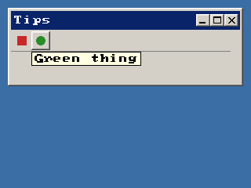

<!-- AUTOGENERATED COPYRIGHT HEADER START -->
<!-- Copyright (C) 2026 Claude <noreply@anthropic.com> -->
<!-- AUTOGENERATED COPYRIGHT HEADER END -->
<!-- Generated by tools/wiki/wiki.py. Edit tools/wiki/text/ instead of this file. -->
# SetToolBarTips

[Command Index](Command-Index) · [BlitzPlus](BlitzPlus) · [Toolbars](BlitzPlus-Toolbars)

```blitzbasic
SetToolBarTips toolbar%, tips$
```

**Works in:** BlitzPlus

Sets the hints for the icons of a toolbar, as a list separated by commas with one for each icon. They are supposed to pop up when the mouse rests over an icon.

```blitzbasic
Graphics 320, 240, 32, 2
strip = CreateImage(32, 16)
SetBuffer ImageBuffer(strip)
Color 255, 0, 255 : Rect 0, 0, 32, 16, 1
Color 200, 40, 40 : Rect 2, 2, 12, 12, 1
Color 40, 140, 40 : Oval 18, 2, 12, 12, 1
SaveImage strip, "icons.bmp"
SetBuffer BackBuffer()
win = CreateWindow("Tips", 10, 10, 300, 100, Desktop(), 3)
bar = CreateToolBar("icons.bmp", 0, 0, 280, 28, win)
SetToolBarTips bar, "Red thing,Green thing"
Repeat
Until WaitEvent() = $803
```



| Parameter | Type | Default | Description |
|---|---|---|---|
| `toolbar` | Int | required | Handle of a toolbar. |
| `tips` | String | required | Hints separated by commas. |

**Differences and known gaps:**

* A hint shows below its button after the mouse rested on it for half a second, in a yellow box, and goes when the mouse moves to another button or is pressed. Spaces between buttons do not take a hint.

## Related commands

* [CreateToolBar](CreateToolBar)
* [DisableToolBarItem](DisableToolBarItem)
* [EnableToolBarItem](EnableToolBarItem)
* [SetGadgetIconStrip](SetGadgetIconStrip)

[Command Index](Command-Index) · [BlitzPlus](BlitzPlus) · [Toolbars](BlitzPlus-Toolbars)
