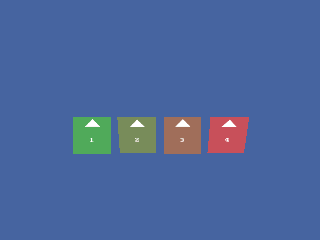

<!-- AUTOGENERATED COPYRIGHT HEADER START -->
<!-- Copyright (C) 2026 Claude <noreply@anthropic.com> -->
<!-- AUTOGENERATED COPYRIGHT HEADER END -->
<!-- Generated by tools/wiki/wiki.py. Edit tools/wiki/text/ instead of this file. -->


# SpriteViewMode

<div align="center">

[Command Index](Command-Index) · [Blitz3D](Blitz3D) · [Sprites](Blitz3D-Sprites)

</div>


## Command Syntax

```blitzbasic
SpriteViewMode sprite:Int32, view_mode:Int32
```

## Description

Chooses how a sprite turns in relation to the camera.

| Mode | Behavior |
|---|---|
| 1 | Faces the camera and turns with it, so it always looks flat towards you. This is the default. |
| 2 | Free: keeps the orientation of the entity itself and ignores the camera, so it can be seen edge-on. |
| 3 | Faces the camera but keeps the entity's own up direction. |
| 4 | Only turns around the vertical axis to face the camera. It stays upright, like a billboard tree. |

The example shows all four modes while the camera circles them and tilts from side to side. The arrow on each sprite points to its up direction.

**Differences and known gaps:**

* The descriptions in the official help do not exactly match the engine. This page describes what the engine does, and so does this runtime.

## Parameters

| Parameter | Type | Default | Description |
|---|---|---|---|
| `sprite` | Int32 | required | The sprite. |
| `view_mode` | Int32 | required | 1 to 4, see the table. Values outside that range select mode 1. |

## Examples

```blitzbasic
Graphics3D 320, 240, 0, 2
SetBuffer BackBuffer()
camera = CreateCamera()
CameraClsColor camera, 70, 100, 160
pivot = CreatePivot()
EntityParent camera, pivot
PositionEntity camera, 0, 3, -8
RotateEntity camera, 15, 0, 0

; One sprite for every view mode, labeled with its number.
For mode = 1 To 4
	tex = CreateTexture(64, 64)
	SetBuffer TextureBuffer(tex)
	ClsColor 40 + mode * 40, 200 - mode * 30, 90
	Cls
	Color 255, 255, 255
	For i = 0 To 12
		Rect 32 - i, 4 + i, i * 2 + 1, 1, 1
	Next
	Text 32, 40, Str(mode), 1, 1
	SetBuffer BackBuffer()

	sprite = CreateSprite()
	SpriteViewMode sprite, mode
	EntityTexture sprite, tex
	PositionEntity sprite, -3.6 + (mode - 1) * 2.4, 0, 0
Next

For frame = 0 To 39
	RotateEntity pivot, 0, frame * 4.5, 0
	RotateEntity camera, 15, 0, Sin(frame * 18) * 35
	RenderWorld
	Flip
Next
```

## Media



## Related Commands

* [CreateSprite](CreateSprite)
* [HandleSprite](HandleSprite)
* [LoadSprite](LoadSprite)
* [RotateSprite](RotateSprite)
* [ScaleSprite](ScaleSprite)

<div align="center">

[Command Index](Command-Index) · [Blitz3D](Blitz3D) · [Sprites](Blitz3D-Sprites)

</div>
