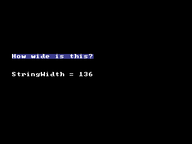

<!-- AUTOGENERATED COPYRIGHT HEADER START -->
<!-- Copyright (C) 2026 Claude <noreply@anthropic.com> -->
<!-- AUTOGENERATED COPYRIGHT HEADER END -->
<!-- Generated by tools/wiki/wiki.py. Edit tools/wiki/text/ instead of this file. -->
# StringWidth

[Command Index](Command-Index) · [BlitzBasic](BlitzBasic) · [Fonts and Text](BlitzBasic-Fonts-and-Text)

```blitzbasic
StringWidth:Int32 string:String
```

**Works in:** Blitz2D, BlitzPlus, Blitz3D

The width in pixels that a text has in the current font. It helps to center text or to put things after it.

```blitzbasic
Graphics 320, 240, 0, 2
SetBuffer BackBuffer()
Cls
Local msg$ = "How wide is this?"
Local w = StringWidth(msg)
Color 60, 60, 140
Rect 20, 90, w, StringHeight(msg), 1
Color 255, 255, 255
Text 20, 90, msg
Text 20, 120, "StringWidth = " + w
Flip
WaitKey
```



| Parameter | Type | Default | Description |
|---|---|---|---|
| `string` | String | required | The text to measure. |

**Returns:** The width of the text.

**Differences and known gaps:**

* With the built-in bitmap font every character has the same width, so this is the number of characters times [FontWidth](FontWidth). Widths of real fonts depend on the font that was found on the system.

## Related commands

* [FontWidth](FontWidth)
* [SetFont](SetFont)
* [StringHeight](StringHeight)
* [Text](Text)

[Command Index](Command-Index) · [BlitzBasic](BlitzBasic) · [Fonts and Text](BlitzBasic-Fonts-and-Text)
