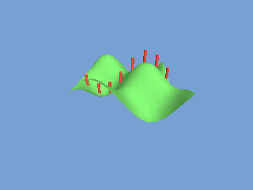

<!-- AUTOGENERATED COPYRIGHT HEADER START -->
<!-- Copyright (C) 2026 Claude <noreply@anthropic.com> -->
<!-- AUTOGENERATED COPYRIGHT HEADER END -->
<!-- Generated by tools/wiki/wiki.py. Edit tools/wiki/text/ instead of this file. -->
# TerrainY

[Command Index](Command-Index) · [Blitz3D](Blitz3D) · [Terrain](Blitz3D-Terrain)

## Command Syntax

```blitzbasic
TerrainY:Float32 terrain:Int32, world_x:Float32, world_y:Float32, world_z:Float32
```

## Description

**Works in:** Blitz3D

Gives the height of the ground at a point of the world, including the terrain's position, scale and the blending between grid points. The Y you pass in does not matter for an upright terrain. This is the simple way to keep something standing on the ground.

## Parameters

| Parameter | Type | Default | Description |
|---|---|---|---|
| `terrain` | Int32 | required | The terrain. |
| `world_x` | Float32 | required |  |
| `world_y` | Float32 | required |  |
| `world_z` | Float32 | required |  |

**Returns:** The world Y coordinate of the ground at that position.

## Examples

```blitzbasic
Graphics3D 320, 240, 0, 2
SetBuffer BackBuffer()
camera = CreateCamera()
CameraClsColor camera, 120, 160, 210
PositionEntity camera, 8, 11, -13
RotateEntity camera, 28, 0, 0
light = CreateLight()
RotateEntity light, 50, 20, 0

land = CreateTerrain(16)
ScaleEntity land, 1, 6, 1
EntityColor land, 90, 170, 80
For z = 0 To 16
	For x = 0 To 16
		ModifyTerrain land, x, z, 0.5 + 0.5 * Sin(x * 24) * Cos(z * 24)
	Next
Next

; Put a row of poles on the ground, whatever its height.
For x = 1 To 15 Step 2
	pole = CreateCylinder(8)
	ScaleEntity pole, 0.25, 1, 0.25
	z# = 8
	PositionEntity pole, x, TerrainY(land, x, 0, z) + 1, z
	EntityColor pole, 220, 70, 60
Next

RenderWorld
Flip
WaitKey
```

## Media



## Related Commands

* [CreateTerrain](CreateTerrain)
* [LoadTerrain](LoadTerrain)
* [TerrainDetail](TerrainDetail)
* [TerrainHeight](TerrainHeight)
* [TerrainShading](TerrainShading)
* [TerrainSize](TerrainSize)
* [TerrainX](TerrainX)
* [TerrainZ](TerrainZ)

[Command Index](Command-Index) · [Blitz3D](Blitz3D) · [Terrain](Blitz3D-Terrain)
