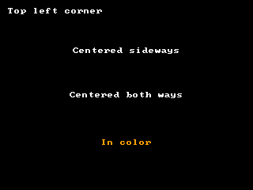

<!-- AUTOGENERATED COPYRIGHT HEADER START -->
<!-- Copyright (C) 2026 Claude <noreply@anthropic.com> -->
<!-- AUTOGENERATED COPYRIGHT HEADER END -->
<!-- Generated by tools/wiki/wiki.py. Edit tools/wiki/text/ instead of this file. -->


# Text

<div align="center">

[Command Index](Command-Index) · [BlitzBasic](BlitzBasic) · [Fonts and Text](BlitzBasic-Fonts-and-Text)

</div>


## Command Syntax

```blitzbasic
Text x:Int32, y:Int32, text:String, centre_x:Int32=0, centre_y:Int32=0
```

## Parameters

| Parameter | Type | Default | Description |
|---|---|---|---|
| `x` | Int32 | required | Horizontal position of the text. |
| `y` | Int32 | required | Vertical position of the text. |
| `text` | String | required | The text to draw. |
| `centre_x` | Int32 | `0` | 1 to use x as the middle of the text instead of its left edge. Defaults to 0. |
| `centre_y` | Int32 | `0` | 1 to use y as the middle of the text instead of its top edge. Defaults to 0. |

## Description

Draws text into the current buffer with the drawing color. The position is the top left corner of the text, unless one of the two centering flags asks for the position to be the middle of the text.

## Differences

* The built-in 8x8 pixel bitmap font is always used, scaled to the height of the current font. Characters 128 and above show the glyphs of the bitmap font, and the text is not smoothed.

## Examples

```blitzbasic
Graphics 320, 240, 0, 2
SetBuffer BackBuffer()
Cls
Color 255, 255, 255
Text 10, 10, "Top left corner"
Text 160, 60, "Centered sideways", 1
Text 160, 120, "Centered both ways", 1, 1
Color 255, 160, 0
Text 160, 180, "In color", 1, 1
Flip
WaitKey
```

## Media



## Related Commands

* [StringHeight](StringHeight)
* [StringWidth](StringWidth)
* [Write](Write)

<div align="center">

[Command Index](Command-Index) · [BlitzBasic](BlitzBasic) · [Fonts and Text](BlitzBasic-Fonts-and-Text)

</div>
