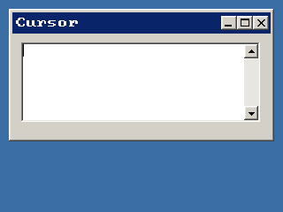

<!-- AUTOGENERATED COPYRIGHT HEADER START -->
<!-- Copyright (C) 2026 Claude <noreply@anthropic.com> -->
<!-- AUTOGENERATED COPYRIGHT HEADER END -->
<!-- Generated by tools/wiki/wiki.py. Edit tools/wiki/text/ instead of this file. -->
# TextAreaCursor

[Command Index](Command-Index) · [BlitzPlus](BlitzPlus) · [Text Areas](BlitzPlus-Text-Areas)

```blitzbasic
TextAreaCursor textarea%, units%=1  ; returns Int
```

**Works in:** BlitzPlus

Gives where the text cursor is.

```blitzbasic
Graphics 320, 240, 32, 2
win  = CreateWindow("Cursor", 10, 10, 300, 150, Desktop(), 3)
area = CreateTextArea(10, 10, 270, 90, win)
ActivateGadget area
Repeat
	e = WaitEvent()
	If e = $401 Then SetGadgetText win, "Cursor " + TextAreaCursor(area) + " line " + TextAreaCursor(area, 2)
Until e = $803
```



| Parameter | Type | Default | Description |
|---|---|---|---|
| `textarea` | Int | required | Handle of a text area. |
| `units` | Int | `1` | 1 gives the character position, 2 gives the line. Defaults to 1. |

**Returns:** The position, counting from 0.

## Related commands

* [AddTextAreaText](AddTextAreaText)
* [TextAreaChar](TextAreaChar)
* [TextAreaLen](TextAreaLen)
* [TextAreaLine](TextAreaLine)
* [TextAreaLineLen](TextAreaLineLen)
* [TextAreaSelLen](TextAreaSelLen)
* [TextAreaText](TextAreaText)
* [TextFieldText](TextFieldText)

[Command Index](Command-Index) · [BlitzPlus](BlitzPlus) · [Text Areas](BlitzPlus-Text-Areas)
