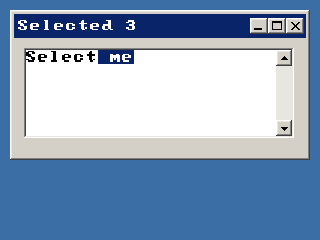

<!-- AUTOGENERATED COPYRIGHT HEADER START -->
<!-- Copyright (C) 2026 Claude <noreply@anthropic.com> -->
<!-- AUTOGENERATED COPYRIGHT HEADER END -->
<!-- Generated by tools/wiki/wiki.py. Edit tools/wiki/text/ instead of this file. -->
# TextAreaSelLen

[Command Index](Command-Index) · [BlitzPlus](BlitzPlus) · [Text Areas](BlitzPlus-Text-Areas)

```blitzbasic
TextAreaSelLen:Int32 textarea:Int32, units:Int32=1
```

**Works in:** BlitzPlus

Gives how much is selected.

```blitzbasic
Graphics 320, 240, 32, 2
win  = CreateWindow("Selection", 10, 10, 300, 150, Desktop(), 3)
area = CreateTextArea(10, 10, 270, 90, win)
ActivateGadget area
Repeat
	e = WaitEvent()
	If e = $401 Then SetGadgetText win, "Selected " + TextAreaSelLen(area)
Until e = $803
```



| Parameter | Type | Default | Description |
|---|---|---|---|
| `textarea` | Int32 | required | Handle of a text area. |
| `units` | Int32 | `1` | 1 counts characters, 2 counts lines. Defaults to 1. |

**Returns:** The size of the selection.

## Related commands

* [AddTextAreaText](AddTextAreaText)
* [TextAreaChar](TextAreaChar)
* [TextAreaCursor](TextAreaCursor)
* [TextAreaLen](TextAreaLen)
* [TextAreaLine](TextAreaLine)
* [TextAreaLineLen](TextAreaLineLen)
* [TextAreaText](TextAreaText)
* [TextFieldText](TextFieldText)

[Command Index](Command-Index) · [BlitzPlus](BlitzPlus) · [Text Areas](BlitzPlus-Text-Areas)
