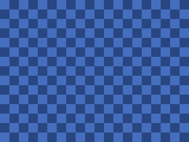

<!-- AUTOGENERATED COPYRIGHT HEADER START -->
<!-- Copyright (C) 2026 Claude <noreply@anthropic.com> -->
<!-- AUTOGENERATED COPYRIGHT HEADER END -->
<!-- Generated by tools/wiki/wiki.py. Edit tools/wiki/text/ instead of this file. -->
# TileBlock

[Command Index](Command-Index) · [BlitzBasic](BlitzBasic) · [Images](BlitzBasic-Images)

```blitzbasic
TileBlock image:Int32, x:Int32=0, y:Int32=0, frame:Int32=0
```

**Works in:** Blitz2D, BlitzPlus, Blitz3D

Fills the whole current buffer with copies of a frame of an image, drawn without transparency. The pattern starts at the given offset, which makes scrolling backgrounds easy: change the offset a little every frame.

```blitzbasic
Graphics 320, 240, 0, 2
SetBuffer BackBuffer()
Local tile = CreateImage(32, 32)
SetBuffer ImageBuffer(tile)
Color 40, 70, 130
Rect 0, 0, 32, 32, 1
Color 70, 110, 190
Rect 0, 0, 16, 16, 1
Rect 16, 16, 16, 16, 1
SetBuffer BackBuffer()
Local n = 0
While n < 40
	TileBlock tile, n, n / 2
	Flip
	n = n + 1
Wend
```



| Parameter | Type | Default | Description |
|---|---|---|---|
| `image` | Int32 | required | The image to repeat. |
| `x` | Int32 | `0` | Horizontal offset of the pattern. Defaults to 0. |
| `y` | Int32 | `0` | Vertical offset of the pattern. Defaults to 0. |
| `frame` | Int32 | `0` | Which frame to use. Defaults to 0. |

## Related commands

* [DrawBlock](DrawBlock)
* [DrawBlockRect](DrawBlockRect)
* [TFormFilter](TFormFilter)
* [TileImage](TileImage)

[Command Index](Command-Index) · [BlitzBasic](BlitzBasic) · [Images](BlitzBasic-Images)
