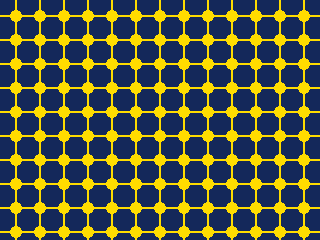

<!-- AUTOGENERATED COPYRIGHT HEADER START -->
<!-- Copyright (C) 2026 Claude <noreply@anthropic.com> -->
<!-- AUTOGENERATED COPYRIGHT HEADER END -->
<!-- Generated by tools/wiki/wiki.py. Edit tools/wiki/text/ instead of this file. -->
# TileImage

[Command Index](Command-Index) · [BlitzBasic](BlitzBasic) · [Images](BlitzBasic-Images)

```blitzbasic
TileImage image%, x%=0, y%=0, frame%=0
```

**Works in:** Blitz2D, BlitzPlus, Blitz3D

Like [TileBlock](TileBlock), but the mask color is left out, so what is behind the tiles shows through.

```blitzbasic
Graphics 320, 240, 0, 2
SetBuffer BackBuffer()
Local star = CreateImage(24, 24)
SetBuffer ImageBuffer(star)
Color 255, 220, 0
Oval 6, 6, 12, 12, 1
Rect 11, 0, 2, 24, 1
Rect 0, 11, 24, 2, 1
SetBuffer BackBuffer()
Cls
Color 20, 40, 90
Rect 0, 0, 320, 240, 1
TileImage star, 4, 4
Flip
WaitKey
```



| Parameter | Type | Default | Description |
|---|---|---|---|
| `image` | Int | required | The image to repeat. |
| `x` | Int | `0` | Horizontal offset of the pattern. Defaults to 0. |
| `y` | Int | `0` | Vertical offset of the pattern. Defaults to 0. |
| `frame` | Int | `0` | Which frame to use. Defaults to 0. |

## Related commands

* [CopyImage](CopyImage)
* [CreateImage](CreateImage)
* [DrawImage](DrawImage)
* [FreeImage](FreeImage)
* [GrabImage](GrabImage)
* [HandleImage](HandleImage)
* [LoadAnimImage](LoadAnimImage)
* [LoadImage](LoadImage)

[Command Index](Command-Index) · [BlitzBasic](BlitzBasic) · [Images](BlitzBasic-Images)
