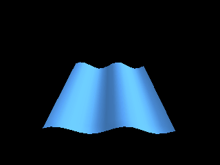

<!-- AUTOGENERATED COPYRIGHT HEADER START -->
<!-- Copyright (C) 2026 Claude <noreply@anthropic.com> -->
<!-- AUTOGENERATED COPYRIGHT HEADER END -->
<!-- Generated by tools/wiki/wiki.py. Edit tools/wiki/text/ instead of this file. -->
# VertexCoords

[Command Index](Command-Index) · [Blitz3D](Blitz3D) · [Surfaces](Blitz3D-Surfaces)

## Command Syntax

```blitzbasic
VertexCoords surface:Int32, index:Int32, x:Float32, y:Float32, z:Float32
```

## Description

**Works in:** Blitz3D

Moves an existing vertex to a new position in the space of the mesh. Every triangle that uses the vertex follows, so changing vertices every frame deforms a mesh: waves on water, a flag in the wind or a dent in a car. Call [UpdateNormals](UpdateNormals) afterwards if the lighting should follow the new shape.

## Parameters

| Parameter | Type | Default | Description |
|---|---|---|---|
| `surface` | Int32 | required | Surface handle. |
| `index` | Int32 | required | Index of the vertex, from 0. |
| `x` | Float32 | required | New X position. |
| `y` | Float32 | required | New Y position. |
| `z` | Float32 | required | New Z position. |

## Examples

```blitzbasic
Graphics3D 320, 240, 0, 2
SetBuffer BackBuffer()
camera = CreateCamera()
PositionEntity camera, 0, 6, -7
RotateEntity camera, 38, 0, 0
light = CreateLight()
RotateEntity light, 40, 60, 0
mesh = CreateMesh()
surf = CreateSurface(mesh)
For z = 0 To 15
	For x = 0 To 15
		AddVertex surf, x * 0.5 - 3.75, 0, z * 0.5 - 3.75
	Next
Next
For z = 0 To 14
	For x = 0 To 14
		i = z * 16 + x
		AddTriangle surf, i, i + 16, i + 1
		AddTriangle surf, i + 1, i + 16, i + 17
	Next
Next
EntityColor mesh, 80, 150, 230
t = 0
While Not KeyHit(1)
	t = t + 12
	For i = 0 To CountVertices(surf) - 1
		VertexCoords surf, i, VertexX(surf, i), Sin(t + VertexX(surf, i) * 90) * 0.4, VertexZ(surf, i)
	Next
	UpdateNormals mesh
	RenderWorld
	Flip
Wend
```

## Media



## Related Commands

* [VertexAlpha](VertexAlpha)
* [VertexBlue](VertexBlue)
* [VertexColor](VertexColor)
* [VertexGreen](VertexGreen)
* [VertexNormal](VertexNormal)
* [VertexNX](VertexNX)
* [VertexNY](VertexNY)
* [VertexTexCoords](VertexTexCoords)

[Command Index](Command-Index) · [Blitz3D](Blitz3D) · [Surfaces](Blitz3D-Surfaces)
