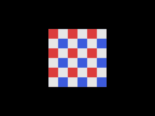

<!-- AUTOGENERATED COPYRIGHT HEADER START -->
<!-- Copyright (C) 2026 Claude <noreply@anthropic.com> -->
<!-- AUTOGENERATED COPYRIGHT HEADER END -->
<!-- Generated by tools/wiki/wiki.py. Edit tools/wiki/text/ instead of this file. -->
# VertexTexCoords

[Command Index](Command-Index) · [Blitz3D](Blitz3D) · [Surfaces](Blitz3D-Surfaces)

## Command Syntax

```blitzbasic
VertexTexCoords surface:Int32, index:Int32, u:Float32, v:Float32, w:Float32=1, coord_set:Int32=0
```

## Description

**Works in:** Blitz3D

Sets which point of the texture a vertex shows. 0, 0 is the top left of the texture and 1, 1 is the bottom right. Values above 1 repeat the texture, so a quad with the coordinates 0 to 3 shows the texture three times in each direction. A second set of coordinates, picked with `coord_set` 1, is used by the second texture layer in the original, for example for light maps.

**Differences and known gaps:**

* `w` is ignored.

## Parameters

| Parameter | Type | Default | Description |
|---|---|---|---|
| `surface` | Int32 | required | Surface handle. |
| `index` | Int32 | required | Index of the vertex, from 0. |
| `u` | Float32 | required | Horizontal texture coordinate. |
| `v` | Float32 | required | Vertical texture coordinate. |
| `w` | Float32 | `1` | Third coordinate, unused. Defaults to 1. |
| `coord_set` | Int32 | `0` | Set of coordinates, 0 or 1. Defaults to 0. |

## Examples

```blitzbasic
Graphics3D 320, 240, 0, 2
SetBuffer BackBuffer()
camera = CreateCamera()
PositionEntity camera, 0, 0, -4
tex = CreateTexture(32, 32)
SetBuffer TextureBuffer(tex)
Color 230, 230, 230
Rect 0, 0, 32, 32, 1
Color 220, 60, 60
Rect 0, 0, 16, 16, 1
Color 60, 90, 220
Rect 16, 16, 16, 16, 1
SetBuffer BackBuffer()
mesh = CreateMesh()
surf = CreateSurface(mesh)
a = AddVertex(surf, -1.5, -1.5, 0)
b = AddVertex(surf, -1.5, 1.5, 0)
c = AddVertex(surf, 1.5, 1.5, 0)
d = AddVertex(surf, 1.5, -1.5, 0)
AddTriangle surf, a, b, c
AddTriangle surf, a, c, d
; The texture is shown 3 times in each direction.
VertexTexCoords surf, a, 0, 3
VertexTexCoords surf, b, 0, 0
VertexTexCoords surf, c, 3, 0
VertexTexCoords surf, d, 3, 3
EntityTexture mesh, tex
EntityFX mesh, 1
RenderWorld
Flip
WaitKey
```

## Media



## Related Commands

* [VertexAlpha](VertexAlpha)
* [VertexBlue](VertexBlue)
* [VertexColor](VertexColor)
* [VertexCoords](VertexCoords)
* [VertexGreen](VertexGreen)
* [VertexNormal](VertexNormal)
* [VertexNX](VertexNX)
* [VertexNY](VertexNY)

[Command Index](Command-Index) · [Blitz3D](Blitz3D) · [Surfaces](Blitz3D-Surfaces)
