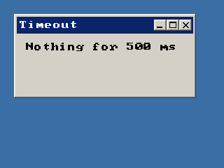

<!-- AUTOGENERATED COPYRIGHT HEADER START -->
<!-- Copyright (C) 2026 Claude <noreply@anthropic.com> -->
<!-- AUTOGENERATED COPYRIGHT HEADER END -->
<!-- Generated by tools/wiki/wiki.py. Edit tools/wiki/text/ instead of this file. -->
# WaitEvent

[Command Index](Command-Index) · [BlitzPlus](BlitzPlus) · [Events](BlitzPlus-Events)

```blitzbasic
WaitEvent timeout%=-1  ; returns Int
```

**Works in:** BlitzPlus

Waits until something happens and gives the kind of event. Use [EventData](EventData), [EventSource](EventSource), [EventX](EventX) and the others to learn more about it. While it waits the windows keep working and are redrawn.

A program with windows is built around a loop with `WaitEvent`. Take every event from one call: calling it again before you read the values throws the earlier event away.

```blitzbasic
Graphics 320, 240, 32, 2
win  = CreateWindow("Timeout", 20, 20, 260, 120, Desktop(), 3)
info = CreateLabel("Waiting", 10, 10, 230, 40, win)
Repeat
	e = WaitEvent(500)
	If e = 0 Then SetGadgetText info, "Nothing for 500 ms"
Until e = $803
```



| Parameter | Type | Default | Description |
|---|---|---|---|
| `timeout` | Int | `-1` | Longest time to wait in milliseconds. -1 waits forever, 0 does not wait. Defaults to -1. |

**Returns:** The kind of the event, or 0 if the time ran out.

## Related commands

* [EventData](EventData)
* [EventID](EventID)
* [EventSource](EventSource)
* [EventX](EventX)
* [EventY](EventY)
* [EventZ](EventZ)
* [PeekEvent](PeekEvent)

[Command Index](Command-Index) · [BlitzPlus](BlitzPlus) · [Events](BlitzPlus-Events)
