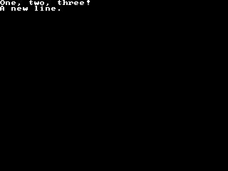

<!-- AUTOGENERATED COPYRIGHT HEADER START -->
<!-- Copyright (C) 2026 Claude <noreply@anthropic.com> -->
<!-- AUTOGENERATED COPYRIGHT HEADER END -->
<!-- Generated by tools/wiki/wiki.py. Edit tools/wiki/text/ instead of this file. -->


# Write

<div align="center">

[Command Index](Command-Index) · [BlitzBasic](BlitzBasic) · [Fonts and Text](BlitzBasic-Fonts-and-Text)

</div>


## Command Syntax

```blitzbasic
Write string:String
```

## Parameters

| Parameter | Type | Default | Description |
|---|---|---|---|
| `string` | String | required | The text to write. |

## Description

Writes text at the text cursor like [Print](Print), but without starting a new line, so the next Write or Print continues behind it.

## Differences

* Without a graphics window the text goes to the console instead.

## Examples

```blitzbasic
Graphics 320, 240, 0, 2
Cls
Write "One, "
Write "two, "
Write "three"
Print "!"
Print "A new line."
WaitKey
```

## Media



## Related Commands

* [StringWidth](StringWidth)
* [Text](Text)

<div align="center">

[Command Index](Command-Index) · [BlitzBasic](BlitzBasic) · [Fonts and Text](BlitzBasic-Fonts-and-Text)

</div>
